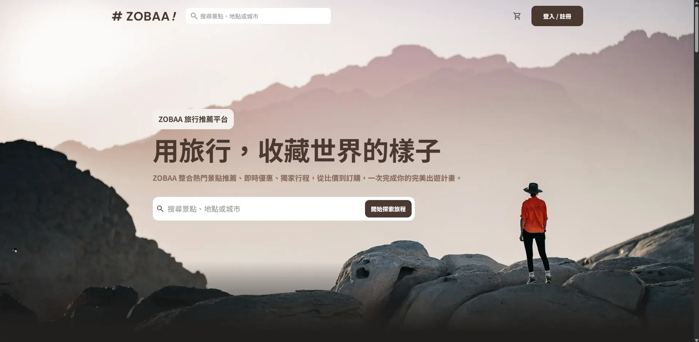
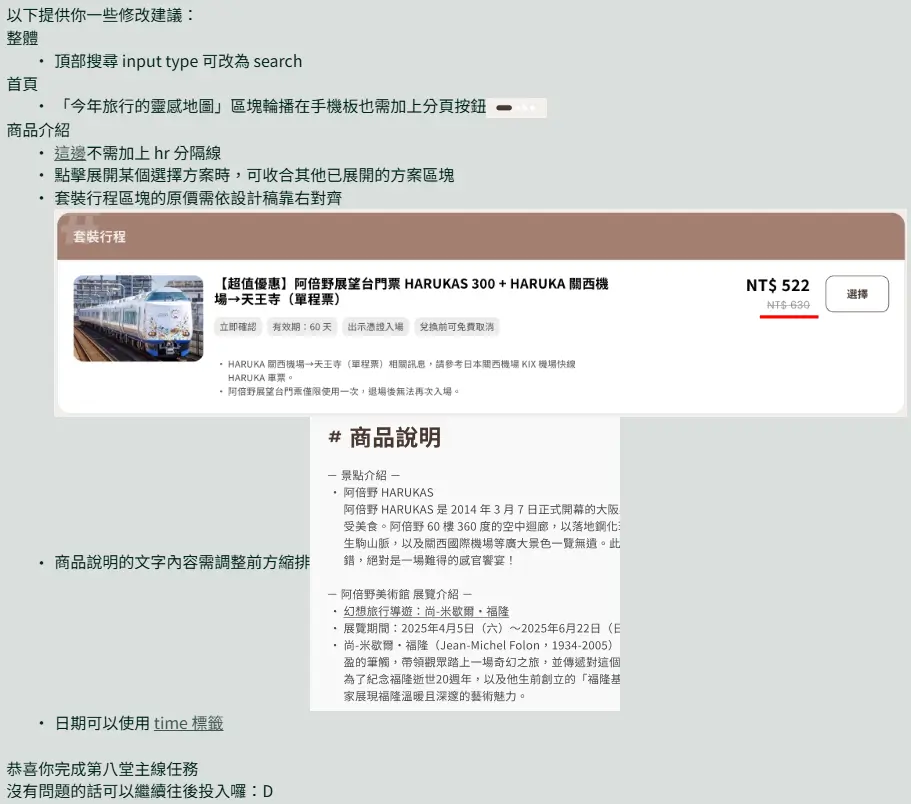

# 六角學院 2025 切版直播班第七、八週作業 — ZOBAA! 旅遊網站

六角學院 2025 切版直播班第七、八週的旅遊網站切版作品，包含首頁、搜尋結果、商品介紹、購物車、登入與會員頁面。畫面依設計稿製作，互動資料僅供展示，沒有串接會員或購物車後端。

- [線上網站](https://zobaa.worksbyaaron.com/)
- [設計稿](https://www.figma.com/design/3bEeuchVUYwmA2PuHAxQVN/%E5%85%AD%E8%A7%92%EF%BD%9CZOBAA--%E6%97%85%E9%81%8A%E7%B6%B2%E7%AB%99--student-ver.%EF%BC%89?node-id=3-6975&p=f&t=kS2To3qZXkfBm7kj-0)

## 使用技術

- Nuxt 4、Vue 3
- Tailwind CSS 4（`@tailwindcss/vite`），設計色票與字級定義於 `tailwind.config.ts`
- Nuxt Swiper（只載入核心與 Autoplay 模組）
- Fontsource 提供 Noto Sans TC 與 Poppins；建置時依頁面文字產生 Noto Sans TC 子集，完整字型在頁面載入後才引入，只供使用者輸入的字使用
- Prettier + `prettier-plugin-tailwindcss` 統一格式與 class 排序

實際版本以 `package.json` 與 `package-lock.json` 為準。

## 開始使用

需要 Node.js 22.22.3+、24.15+ 或 26+ 與 npm：

```sh
git clone https://github.com/happyloa/Hex2025-f2e-live-week7and8.git
cd Hex2025-f2e-live-week7and8
npm ci
npm run dev        # http://localhost:3000/
```

其他指令：

```sh
npm run build      # 建立正式環境版本
npm run preview    # 預覽正式環境版本
npm run typecheck  # 檢查 TypeScript 與 Vue 型別
npm run format     # 以 Prettier 格式化（format:check 只檢查）
```

## 頁面

| 路徑                                    | 內容                     |
| --------------------------------------- | ------------------------ |
| `/`                                     | 首頁                     |
| `/search-result`                        | 搜尋結果                 |
| `/product-info`                         | 商品介紹                 |
| `/cart`、`/cart?hasItems`               | 購物車空狀態與有商品狀態 |
| `/login`、`/register`                   | 登入與註冊               |
| `/my-account`、`/my-account/saved-info` | 會員頁面                 |

## 目錄

- `app/pages`：頁面，依檔案路徑產生路由
- `app/components`：共用卡片、輪播、頁首頁尾與方案詳情元件
- `app/layouts`：登入／註冊與會員版面
- `app/composables/useAuth.ts`、`app/middleware`：展示用的登入狀態，進入會員頁面時設為已登入
- `app/plugins`、`app/lib`：延後載入完整字型、安裝用到的 Swiper 模組
- `app/utils/number.ts`：千分位格式化 `toThousand`
- `app/assets/css`：Tailwind 進入點與自訂樣式
- `build/font-subsets.ts`：建置時產生字型子集的 Nuxt 模組（需要 `fontkit` 判斷字型涵蓋的字元）
- `public`：圖片、圖示與社群分享圖

## 展示行為

- 登入／註冊：必填欄位填寫後即可送出並進入會員頁面，不做帳號驗證。
- 進入會員頁面時，導覽列切換為已登入狀態；此狀態不會保存，在其他頁面重新整理後即恢復未登入。
- 商品介紹：一次只展開一個方案，總金額依數量計算。
- 購物車：使用頁面內的範例資料，`/cart?hasItems` 顯示有商品畫面；數量、勾選與刪除只影響目前頁面。

## 2025/08/15 助教修改建議


